# claude-devkit

Rules, skills, agents and hooks that make an AI coding assistant work in small reviewed steps, with a plan and a memory, in Claude Code, OpenCode, Codex, Kimi or any harness that reads instruction files.

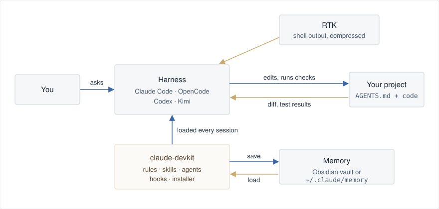

## The problem

On Monday you open Claude Code in your app and write "add login". You also tell it "use pnpm, not npm".

The agent starts typing right away. It changes a dozen files in one pass, skips the tests and hands you a diff too big to review. On Thursday a new session runs `npm install`, because Monday's preference died with Monday's session. On Friday you try the same repository in OpenCode, and none of the instructions you wrote for Claude Code are there.

Three things cause this:

- Nothing decides how much process a task deserves, so a login and a typo get the same treatment.
- Every session starts empty. A correction you made last week does not exist this week.
- Each harness reads its own files in its own format.

claude-devkit adds one layer that every harness loads:

- `ai-effort` picks the level: direto, enxuto or completo.
- The `manager` skill runs a 7-step pipeline with an approval gate before any code.
- `devkit-memory` keeps preferences and lessons in plain Markdown.
- The installer puts the same rules and skills into each harness you use.

## How it works

The installer copies the kit into the harness. From then on the harness loads the golden rules in every session. The rules call `ai-effort`, which hands larger tasks to `manager`.

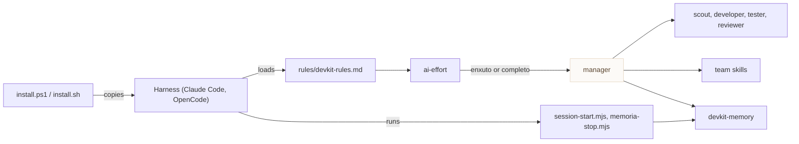

A completo task, from the request to the end of the session:

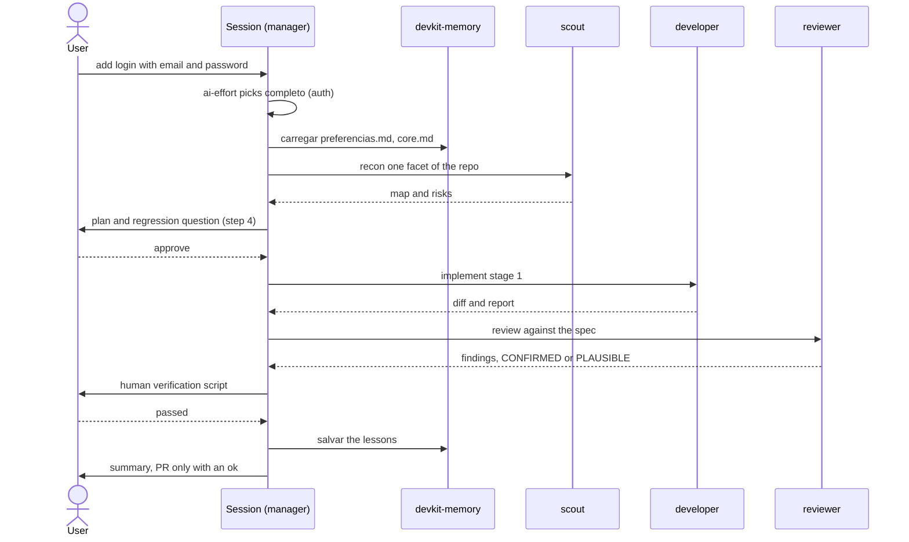

## Features

<!-- super-readme:feature effort-levels -->
### Effort levels

The assistant decides by itself how much process a request deserves, before it touches code.

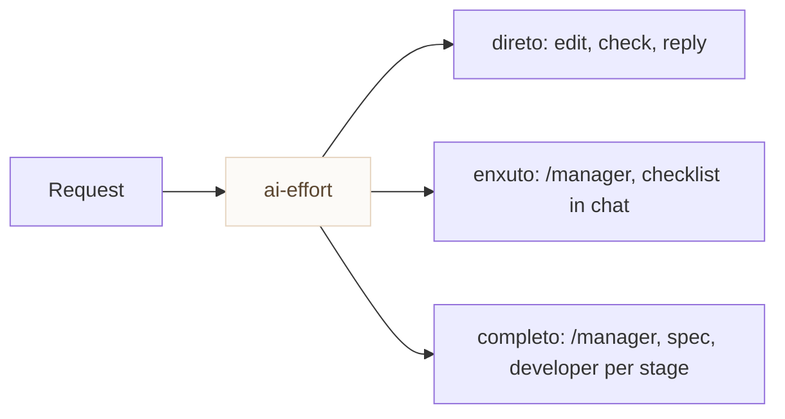

| Level | When | What it does |
|---|---|---|
| Direto | Small tweak, obvious bug, text, question | No manager, no subagent. Reads `AGENTS.md`, edits, runs the relevant check. |
| Enxuto | Medium feature, several files, bug without an obvious cause | `/manager` with a checklist in the chat, 0 or 1 scout, the session implements. |
| Completo | Real user data, auth, payment, migration, change hard to reverse | `/manager` with scouts, spec, approval, one `developer` per stage, validation loop. |

**Example:** "fix the typo in the README" → direto. "add login" → completo, because it touches authentication. When torn between two levels, the skill picks the smaller one if the change is easy to reverse.
<!-- /super-readme:feature effort-levels -->

<!-- super-readme:feature manager-pipeline -->
### The manager pipeline

`/manager` turns your session into a coordinator that takes a task from the request to the PR, in seven steps, with no code before your approval.

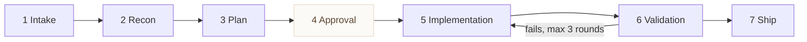

| # | Step | Enxuto (default) | Completo |
|---|---|---|---|
| 1 | Intake | Memory, `AGENTS.md` (creates it if missing), reworded request | same, plus `ai-stack` if it is a new project |
| 2 | Recon | `rg` in the session itself (or 1 scout) | 1 to 2 scouts in parallel |
| 3 | Plan | Checklist in the chat | OpenSpec + grill only for what is hard to reverse + `doubt` once |
| 4 | Approval | One question: plan + regression tests | same |
| 5 | Implementation | The session itself | `developer` per stage, commit per stage |
| 6 | Validation | checks, `tester` (if wanted), `goal`, in a loop of up to 3 rounds, and human verification | plus `reviewer` |
| 7 | Ship | `super-readme feature <slug>` (skipped when nothing visible changed), PR with ok, `devkit-memory salvar` | same, archives the change |

Invariants that must not be broken:

- Recon is never skipped (it can be 2 commands).
- No line of code before approval (step 4).
- Maximum 2 scouts, always in parallel, with orthogonal facets.
- One developer at a time on the same code.
- No PR before the human verification has been answered.
- No PR or push without explicit ok.

The canonical detail is in `skills/manager/SKILL.md`.

**Example:** `/manager add login` → each reply starts with `[manager] 1/7 Intake · completo`, and the session stops at step 4 with two questions: approve the plan, and which regression tests to write.
<!-- /super-readme:feature manager-pipeline -->

<!-- super-readme:feature golden-rules -->
### Golden rules

Nineteen rules in `rules/devkit-rules.md` apply to every session, with or without `/manager`: proportional effort, nothing destructive without approval, one limited task at a time, human review, every fixed failure becomes a test or a rule.

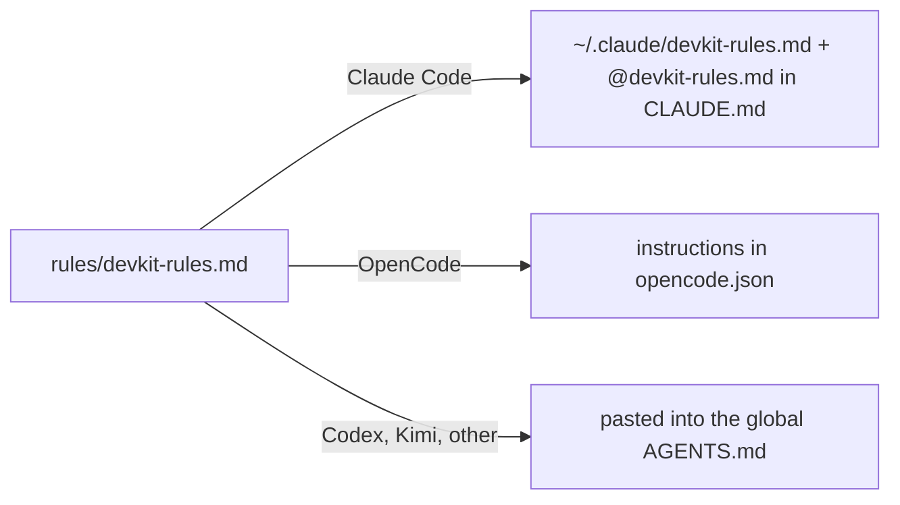

**Example:** rule 5 (model routing) makes the agent announce every model switch in one line: `modelo mudou para haiku` in Portuguese, `model changed to haiku` in English.
<!-- /super-readme:feature golden-rules -->

<!-- super-readme:feature teams -->
### Teams

A team is a coordination skill. It tells the manager who works on a task in one area, what each member receives and how delivery is validated. It is not a plugin and not an agent.

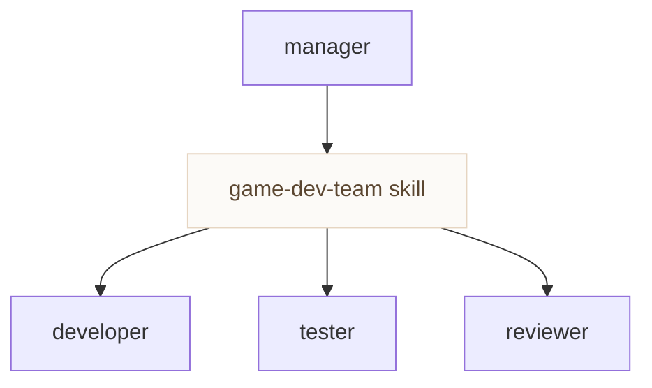

| Team | When to use | Members in OpenCode | Validation |
|---|---|---|---|
| `game-dev-team` | `project.godot`, `*.tscn`, `*.gd` | `godot`, `godot-gdscript`, `tester`, `reviewer` | GUT/gdUnit4 headless, parse/import, scene screenshot |
| `frontend-team` | React/Next/Vue/Angular, `src/`, CSS | `frontend`, `visual-validator`, `tester`, `reviewer` | lint/typecheck/test/build + browser, screenshot, console and network |
| `backend-team` | API, database, migration, auth | `backend`, `tester`, `reviewer`, `scout` | real API, test database, migration up/down, contract |
| `react-native-team` | `react-native`, `expo`, `android/`, `ios/` | `react-native`, `tester`, `visual-validator`, `reviewer` | emulator/device, screenshot, logcat, permissions |
| `regression-team` | confirmed bug, critical flow without coverage | `regression-tester`, `tester`, area specialist, `reviewer` | test fails before, passes after, neighboring suite green |

In Claude Code the same teams use `developer`, `tester` and `reviewer`, with the domain context inside the team skill. There is no specialized Claude agent for Godot, React Native or backend in this repository. The format comes from the teams at [Agnthub](https://app.agnthub.sh/teams?team=game-dev-team); the example there is Unity, the team here is Godot.

The test is run by the AI, with evidence in `docs/testing/`. The human reviews the report and the checklist afterwards.

**Example:** a repository with `project.godot` → the manager loads `game-dev-team` and validates with GUT or gdUnit4 headless before asking you to play the scene.
<!-- /super-readme:feature teams -->

<!-- super-readme:feature agents -->
### Agents

Four subagents that the manager, or any session at any time, can call to save context. The manager itself is not an agent: it is the `manager` skill running in your session.

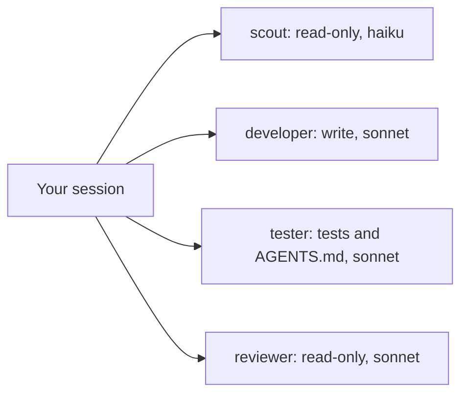

| Agent | Permission | Role |
|---|---|---|
| `scout` | read-only | Reconnaissance of one facet of the project. Max. 2 per task, in parallel. |
| `developer` | write | Implements **one stage** of the approved spec. Nothing beyond the stage. |
| `tester` | write (only tests and `AGENTS.md`) | Creates personas, tests as them, records findings and turns them into a regression suite in `AGENTS.md`. |
| `reviewer` | read-only | Reviews what was done against the spec. Also reviews PRs. |

The models are fixed in each file's frontmatter (`claude-haiku-5-5` for `scout`, `claude-sonnet-5-5` for the others). The OpenCode versions, plus the team specialists, live in `config/opencode/agents/`.

**Example:** "run the reviewer on the branch diff" → `reviewer` returns findings marked `CONFIRMED` (goes back to implementation) or `PLAUSIBLE` (goes to you).
<!-- /super-readme:feature agents -->

<!-- super-readme:feature devkit-memory -->
### Memory that learns

`devkit-memory` keeps what changes how the agent works (preferences, spec decisions, pipeline lessons) in Markdown files you can open and edit. Next week's session reads them before it starts.

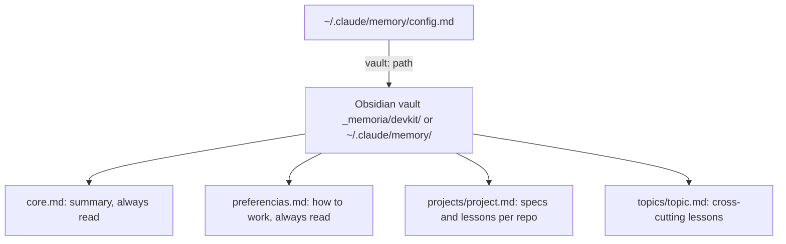

Commands: `/devkit-memory salvar <observation>`, `buscar <term>`, `carregar`, `ver`, `esquecer <topic>`, `consolidar`. No database, no semantic search: grep over Markdown.

**Example:** `/devkit-memory salvar use pnpm, not npm` → a dated entry `## Use pnpm [2026-11-25]` in `preferencias.md`, and the reply "Saved to `<path>`."
<!-- /super-readme:feature devkit-memory -->

<!-- super-readme:feature session-hooks -->
### Session banner and memory reminder

Two Claude Code hooks: one opens every session with the two steps that belong to you, the other stops the agent from forgetting to save a correction you just made.

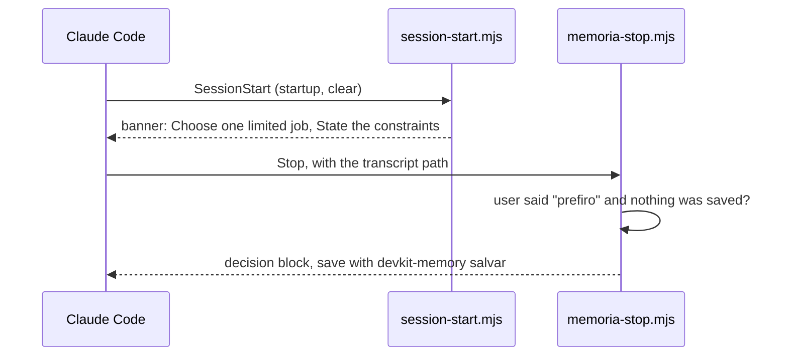

Both use no network. `DEVKIT_BANNER=off` turns the banner off, `DEVKIT_BANNER_COLOR=off` removes its color, `DEVKIT_MEMORIA=off` turns the reminder off. The reminder blocks at most once per turn.

**Example:** you write "prefiro pnpm" and the turn ends without a `devkit-memory` call → `memoria-stop.mjs` prints `{"decision":"block", ...}` and the agent saves the preference before stopping.
<!-- /super-readme:feature session-hooks -->

<!-- super-readme:feature multi-harness-install -->
### One installer, several harnesses

`install.ps1` and `install.sh` put the same kit into Claude Code, OpenCode, and every harness that reads `SKILL.md` folders. They never overwrite without `--force`.

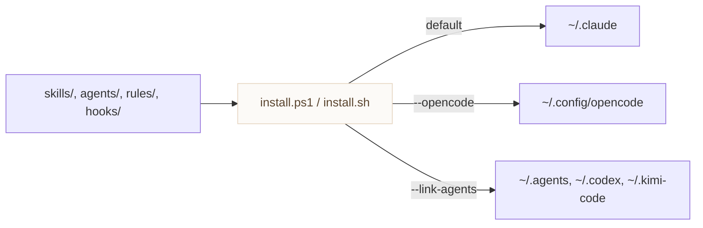

| Feature | Claude Code | OpenCode | Codex / Kimi / other |
|---|---|---|---|
| Skills (`SKILL.md`) | yes | yes | yes, if the harness reads `SKILL.md` |
| Golden rules | `CLAUDE.md` import | `instructions` in `opencode.json` | paste into the global instructions file |
| Agents (`scout`, `developer`, `reviewer`, `tester`, teams) | `agents/` (Claude format) | `config/opencode/agents/` | not installed; the skills still work, and the manager uses agents only if they exist |
| Session banner and memory reminder | yes (hooks) | no (not ported) | no |
| RTK token savings | `rtk init -g` hook | `rtk.ts` plugin | per harness, see `tools/rtk.md` |
| Free-model fallback | no | `opencode-auto-fallback` (config installed) | no |

**Example:** `.\install.ps1 -DryRun -NoHooks -NoRules -Dest "$env:TEMP\claude-devkit-test"` → lists 37 skills and 4 agents under `== installed ==` with `[dry-run]`, then `== skipped ==` and `== pending ==` with `(none)`, and writes nothing.
<!-- /super-readme:feature multi-harness-install -->

## Quickstart

### Install it with your AI

1. Download or clone this repository and open your AI harness in its folder.
2. Paste this prompt into the chat:

```text
Read README.md in this folder and configure claude-devkit for the harness I am using now.
Detect which harness it is (Claude Code, OpenCode, Codex, Kimi, or other) and follow the
"For the AI" section for that harness. Run the installer in dry-run mode first and show me
what it would change. Ask me before writing to any global file (settings, CLAUDE.md,
AGENTS.md, config files) and before installing RTK, MCP servers, or the memory vault.
Do not commit, push, merge, or open a PR. At the end, list what changed, where, and how to undo it.
```

If your harness is not in the list, say so in the prompt. The AI then copies `skills/` into the skills folder your harness reads, and adds the content of `rules/devkit-rules.md` to its global instructions file.

### Or see what the installer would do

Dry run into a throwaway folder; it writes nothing:

```powershell
.\install.ps1 -DryRun -NoHooks -NoRules -Dest "$env:TEMP\claude-devkit-test"   # Windows
```

```bash
./install.sh --dry-run --no-hooks --no-rules --dest /tmp/claude-devkit-test   # macOS / Linux / Git Bash
```

Then restart the harness and type `/manager` to start a task.

## Upgrading from an earlier version

Already had claude-devkit installed, and just downloaded this version? Paste this prompt into your AI, from this folder. It upgrades your existing installation without reinstalling everything from scratch.

```text
I already had claude-devkit installed and I just downloaded the new version into this folder.
Upgrade my existing installation to this version. Read README.md, section "Upgrading from an
earlier version", and follow it.

Rules:
- Show me each change before making it. Ask for my ok per block (A to G).
- Back up every file or folder you change into <destination>/.devkit-backups/upgrade-<timestamp>/ first.
- Delete nothing that is not part of claude-devkit.
- Do not touch ~/.claude/memory/ or my Obsidian vault. That is my data, and its paths did not change.
- Do not commit, push, merge, or open a PR.
- Never print secret values. Report whether a variable is set, not what it contains.

A. Detect. Find the destination (~/.claude unless I say otherwise) and list its skills, agents,
   hooks, settings.json, CLAUDE.md and devkit-rules.md. Check whether ~/.config/opencode, ~/.codex,
   ~/.kimi-code or ~/.agents exist. Ask me which harnesses I use. Skip any harness I do not use.

B. Find what the previous version left behind, and report it:
   - skills jev-router and ai-memory (ai-memory is now devkit-memory)
   - hooks/jev-hooks.mjs
   - hook entries in settings.json whose command contains jev-hooks.mjs
   - MCP server jev-browser (claude mcp list)
   - plugin typesafe@typesafe-ai and marketplace typesafe-ai (claude plugin list)
   - environment variable TYPESAFE_API_KEY (user scope)
   - agents/manager.md, if it exists (legacy: the manager is now only a skill)

C. Install the new files. Dry run first:
   ./install.sh --dry-run        (or .\install.ps1 -DryRun)
   The installer skips anything that already exists, so it will not update older files by itself.
   Compare every "skipped" item with this folder (SHA-256). For each one that differs, show me a
   one-line summary of the difference and ask whether to replace it. Replace only what I approve,
   after backup, by copying the file or folder from this folder. Do not use --force for the whole kit.
   Ask about these skills separately, because they may be mine: grill-me, doubt, simplify.
   Items that usually differ after this upgrade: devkit-rules.md, agents/developer.md,
   agents/reviewer.md, agents/scout.md, agents/tester.md, hooks/memoria-stop.mjs,
   hooks/session-start.mjs, and the skills manager, ai-effort and ai-stack.
   New items to install: devkit-memory and the team skills (game-dev-team, frontend-team,
   backend-team, react-native-team, regression-team), plus architecture-diagramming,
   design-reference-workflow, game-production and image-prompt-handoff.

D. Remove Jev and TypeSafe. Ask before each step:
   1. Delete hooks/jev-hooks.mjs (after backup).
   2. Delete the jev-router skill folder (after backup).
   3. Run the new hook merge, which removes the Jev entries and keeps every other hook:
      node hooks/merge-settings.mjs <settings.json> <hooks-dir>
      It also registers the session banner and the memory reminder. That is expected.
   4. claude mcp remove jev-browser -s user
   5. claude plugin uninstall typesafe@typesafe-ai
      claude plugin marketplace remove typesafe-ai
   6. Remove TYPESAFE_API_KEY from the user environment.
      Windows: [Environment]::SetEnvironmentVariable('TYPESAFE_API_KEY', $null, 'User')
      macOS/Linux: delete the export line from the shell profile.
   7. Tell me to revoke the key in my TypeSafe account. You cannot do that for me.

E. Rename ai-memory to devkit-memory. First confirm that devkit-memory is installed. Then remove
   the old skills/ai-memory folder (after backup). Keep ~/.claude/memory/ and the vault as they are.

F. Rules. Replace ~/.claude/devkit-rules.md with rules/devkit-rules.md (after backup). Keep the
   @devkit-rules.md line in CLAUDE.md. Rule 5 changed: it no longer mentions jev-router.
   If I use OpenCode, copy rules/devkit-rules.md to ~/.config/opencode/devkit-rules.md as well,
   or run the installer with --opencode --no-claude (or -OpenCode -NoClaude) for that harness only.

G. Verify:
   - No folder named ai-memory remains in the skills folder, and devkit-memory is there.
   - settings.json has no jev-hooks.mjs entries. Run: grep -c jev ~/.claude/settings.json (expect 0).
   - claude mcp list shows no jev-browser.
   - rtk --version still works.
   - Restart the harness. Confirm that /manager and /devkit-memory are listed.
   - If this folder has scripts/check-team-skills.ps1, run it and paste the result.

Report at the end: a table of what I changed, what I kept, the backup folder, and what I still need
to do (for example, revoke the TypeSafe key and delete the backups once I am satisfied).
```

## For the AI

When the user asks you to install this kit, follow these steps in order. Do not skip the verification. Do not invent paths. Do not write to a global file without the user's ok.

### 1. Detect the harness and pick the installer

| Harness | How to recognize it | Installer | What it writes |
|---|---|---|---|
| **Claude Code** | you are running inside Claude Code | `./install.sh` (macOS/Linux/Git Bash) or `.\install.ps1` (Windows PowerShell) | `~/.claude/skills`, `~/.claude/agents`, `~/.claude/devkit-rules.md`, and a `@devkit-rules.md` line in `~/.claude/CLAUDE.md`. Hooks in `~/.claude/settings.json` (see Claude-only steps). |
| **OpenCode** | you are running inside OpenCode | `./install.sh --opencode --no-claude` or `.\install.ps1 -OpenCode -NoClaude` | `~/.config/opencode/` (skills, agents, RTK plugin, rules, instructions file, `opencode.json` merged). The fallback config goes to `%APPDATA%\opencode\fallback.json` on Windows and `~/.config/opencode/fallback.json` elsewhere. Without `-NoClaude` it also installs the Claude Code parts. |
| **Codex, Kimi, shared folder** | the harness reads `SKILL.md` from a skills folder | `./install.sh --no-claude --link-agents` or `.\install.ps1 -NoClaude -LinkAgents` | Copies the skills to `~/.claude/skills` (the shared store) and links each one into `~/.agents/skills`, `~/.codex/skills`, `~/.kimi-code/skills` and `~/.config/opencode/skills`, only where those folders already exist. |
| **Other** | none of the above | copy the skills by hand | Copy each `skills/<name>/` folder into the skills folder your harness reads. Add `rules/devkit-rules.md` to its global instructions file. |

Ask the user which harness to configure if you cannot tell. Ask whether the install is **global** (for all projects, the default) or **project only** (`--dest <project>/.claude` for Claude Code; the OpenCode and link modes are always global).

### 2. Run the installer in dry-run mode, then for real

Dry run first. Show the user the three lists it prints (installed, skipped, pending) and wait for the ok:

```powershell
.\install.ps1 -DryRun        # Windows
```

```bash
./install.sh --dry-run       # macOS / Linux / Git Bash
```

Add the harness flag (`-OpenCode`, `-LinkAgents`, `--opencode`, `--link-agents`) to the dry run when the harness is not Claude Code.

The installer **never overwrites without `--force`**. An item under "skipped" needs the user's decision: keep what already exists, or run again with `--force`. Do not decide on your own, because overwriting a skill the user already uses is hard to reverse. `--force` keeps a backup of what it replaces in `.devkit-backups/<timestamp>/`, outside `skills/` and `agents/`.

Options: `--no-claude` / `-NoClaude` (skip the Claude Code specifics: agents, `CLAUDE.md` import and hooks; skills are still copied to the shared store), `--no-hooks` / `-NoHooks` (skip the Claude Code hooks), `--no-rules` / `-NoRules` (do not import the golden rules), `--dest <path>` / `-Dest <path>` (alternative shared destination, `~/.claude` by default), `--opencode-dest <path>` / `-OpenCodeDest <path>` (alternative OpenCode destination).

### 3. Import the golden rules

The rules are in `rules/devkit-rules.md`. How they load depends on the harness:

- **Claude Code:** the installer copies the file to `~/.claude/devkit-rules.md` and appends `@devkit-rules.md` to `~/.claude/CLAUDE.md` (backup kept). Tell the user the rules apply to all his sessions. To remove them, delete that line.
- **OpenCode:** the installer copies the rules to `~/.config/opencode/devkit-rules.md` and lists it, with `devkit-opencode.md`, in the `instructions` of `opencode.json`. It replaces older devkit entries there.
- **Other harnesses:** add the content of `rules/devkit-rules.md` to the global instructions file (for example `AGENTS.md`). In projects, `AGENTS.md` is the source; `CLAUDE.md` contains only `@AGENTS.md`.

### 4. Install the optional parts (ask for each one)

- **RTK (recommended, token savings).** Follow `tools/rtk.md`: install the binary, make sure `ripgrep` is on the PATH. Then:
  - Claude Code: run `rtk init -g`. **Before running it, tell the user it writes a global `PreToolUse` hook into `~/.claude/settings.json`**, which applies to all his sessions. If he refuses, report the installation as incomplete instead of carrying on silently.
  - OpenCode: the `rtk` plugin is installed with `-OpenCode`. It needs the `rtk` binary on the PATH.
- **Chrome MCP.** The installer does not touch MCP. Open `mcp/README.md` and ask which option he wants: A (Claude in Chrome extension, Claude Code) or B (`chrome-devtools-mcp` via npx, any harness). Do not register an MCP server without asking.
- **Memory vault.** Ask for the path of the Obsidian vault where the shared memory will live (`<vault>/_memoria/devkit/`). Save it in `~/.claude/memory/config.md` (`vault: <path>`), after confirming the folder exists. Without a vault, the memory stays in `~/.claude/memory/`.
- **OpenUI.** Ask whether the user wants OpenUI in the current project. If yes, follow `tools/openui.md`.
- **OpenCode fallback plugin.** The installer writes `fallback.json` and lists `opencode-auto-fallback@0.4.61` in `opencode.json`. Tell the user to run `opencode plugin add opencode-auto-fallback@0.4.61` and restart OpenCode if the plugin is not loaded.

### 5. Claude Code only: effort of the main session

Each subagent declares `model` and `effort` in its own frontmatter, so there is nothing to install for them. The **spec**, however, is written by the manager running as the main session, and there the frontmatter does not apply. What counts is `~/.claude/settings.json`.

Before writing, **read the current `settings.json`, show the user what will change, and ask for ok**. Merge; never overwrite the file, since it probably already has the RTK hook and other keys.

```json
{
  "modelSettings": {
    "claude-sonnet-5": { "effort": "high" }
  }
}
```

Only that entry. **Do not write `model` or `effortLevel`**: this file applies to all of the user's sessions, in every project, and the kit does not decide the model for work outside the devkit. He remains the one who chooses the model, via `/model`.

The agents use fixed model IDs (`claude-sonnet-5`, `claude-haiku-4-5`), not aliases. When a new model generation comes out, review the agent files in `agents/` and this entry.

### 6. Claude Code only: hooks (installed by default)

The installer copies `hooks/session-start.mjs` and `hooks/memoria-stop.mjs` to `~/.claude/hooks/` and registers them in `settings.json` with `hooks/merge-settings.mjs`. The merge keeps the user's other hooks and writes a backup in `.devkit-backups/`. Requires Node 22+; without Node the installer warns and skips them.

- **Session banner** (`session-start.mjs`): when a session opens (`startup` and `clear`), it shows, in large colored font, two steps: **choose a limited task** and **write the constraints**. It uses no network. `DEVKIT_BANNER=off` turns it off; `DEVKIT_BANNER_COLOR=off` removes the color.
- **Memory reminder** (`memoria-stop.mjs`): when the user corrects the agent or states a preference and nothing was saved, it asks the agent to save it with `devkit-memory`. It uses no network. It blocks at most once per turn. `DEVKIT_MEMORIA=off` turns it off.

To remove them: `node hooks/merge-settings.mjs ~/.claude/settings.json ~/.claude/hooks --remove`.

### 7. Verify

Confirm the installation with the commands for the harness:

```bash
ls ~/.claude/skills ~/.claude/agents          # Claude Code, bash
rtk --version && rtk init --show              # RTK binary and hook
grep -A3 modelSettings ~/.claude/settings.json  # Claude Code only
```

```powershell
Get-ChildItem "$HOME\.claude\skills","$HOME\.claude\agents"   # Claude Code, PowerShell
rtk --version; rtk init --show
Select-String modelSettings "$HOME\.claude\settings.json"
```

For OpenCode, run `opencode debug agents` and confirm that `manager` is listed as `primary` and the specialists as `subagent`. Restart the harness so it loads the new skills and agents. Confirm that `/manager` appears, and that `scout`, `developer`, `reviewer` and `tester` are listed. If an old `~/.claude/agents/manager.md` exists, delete it: the manager is now only the skill.

### What NOT to do during installation

- Do not copy a skill without `SKILL.md` (an empty folder is pending content).
- Do not edit skills that already existed in the destination.
- Do not register an MCP server without asking.
- Do not treat RTK as optional: skipping it leaves the installation incomplete.
- Do not commit anything to the user's repository as part of the installation.

## Uninstall

Ask your AI to uninstall, or do it by hand. Claude Code:

```bash
rm -rf ~/.claude/skills/{manager,ai-effort,ai-stack,devkit-memory,goal,grill-with-docs,ponytail-review,caveman,fact-check,reflect,verification-planning,agent-browser,clonedeps,humanizer,pr-bump,improve-codebase-architecture,worktrees,release,security-audit,deepwork,loop-engineering,codemap,lesson,video-lesson,super-readme,architecture-diagramming,design-reference-workflow,game-production,image-prompt-handoff,game-dev-team,frontend-team,backend-team,react-native-team,regression-team}
rm -f ~/.claude/agents/{manager,scout,developer,reviewer,tester}.md ~/.claude/devkit-rules.md   # and the @devkit-rules.md line in CLAUDE.md
node hooks/merge-settings.mjs ~/.claude/settings.json ~/.claude/hooks --remove               # devkit hooks only
```

OpenCode: remove the same skills from `~/.config/opencode/skills`, the `config/opencode` agents from `~/.config/opencode/agents`, and the devkit entries from `opencode.json`.

`grill-me`, `doubt` and `simplify` may already belong to the user — confirm with him before deleting. Deleting the `devkit-memory` skill does **not** delete `~/.claude/memory/`: the content belongs to the user and only leaves if he asks. What `--force` overwrites goes to `.devkit-backups/<timestamp>/` in the destination, outside `skills/` and `agents/` — a backup inside `skills/` is loaded by the harness as a real skill.

## Structure

```
claude-devkit/
├── README.md              ← this file (explainer and installation manual)
├── AGENTS.md              ← guide for agents working on this repository
├── install.sh / .ps1      ← installer (Claude Code by default; --opencode / -OpenCode; --link-agents / -LinkAgents)
├── skills/<name>/SKILL.md ← one folder per skill
├── agents/<name>.md       ← Claude Code agents
├── config/opencode/       ← OpenCode bundle: opencode.json, fallback.json, agents, RTK plugin, instructions
├── rules/devkit-rules.md  ← golden rules, imported by the harness's global instructions
├── hooks/                 ← session banner, memory reminder, merge-settings.mjs
├── scripts/               ← new-branch, checks, open-pr, team-skill checks (.sh and .ps1)
├── mcp/                   ← config and instructions for Chrome
├── tools/                 ← external tools (rtk, openspec, openui), installed separately
├── openspec/              ← OpenSpec changes and specs for this repository
├── docs/                  ← README images, design references, test reports
└── tests/                 ← test cases for skills
```

To add something new: create the folder/file in the right place. The installer scans the directories — there is no need to register it in any list.

## Reference

### Skills

| Skill | Origin | Role |
|---|---|---|
| `grill-me` | internal | Interviews the user until every open decision in the plan is closed. Version without the record of `grill-with-docs`. |
| `grill-with-docs` | internal (idea from [mattpocock/skills](https://github.com/mattpocock/skills/blob/main/docs/engineering/grill-with-docs.md)) | `grill-me` that also writes ADRs in `docs/adr/` for decisions that are hard to reverse. Step 3 of the manager (full mode). |
| `goal` | internal | Checks the implementation against the spec and the goal. Step 6. |
| `doubt` | external | Adversarial review before a decision that is hard to reverse. Step 3 of the manager (full mode). |
| `simplify` | external (adapted target) | Simplifies the **spec and the explanation given to the user**, not the approved code. Standalone use. |
| `manager` | internal | The session itself becomes the manager (never a subagent) and runs the 7-step pipeline, in lean or full mode. |
| `devkit-memory` | internal (design inspired by [hanfang/claude-memory-skill](https://github.com/hanfang/claude-memory-skill)) | Persistent memory (in the Obsidian vault, with fallback to `~/.claude/memory/`; `/devkit-memory consolidar` reorganizes and archives the junk) of what changes **how** the agent works: code preference, spec decision, pipeline lesson. Read in step 1, written in step 7. |
| `ai-effort` | internal | The AI decides the effort by itself (direct, lean or full) and the test level. Applies even without `/manager`. |
| `ai-stack` | internal | New project: 4 key questions (users, data, security, platform) and a suggestion of language, database and app type, with UI references. |
| `architecture-diagramming` | internal | Reviews architecture diagrams drawn in Excalidraw, explains them and suggests concrete edits. |
| `design-reference-workflow` | internal | Finds and compares a few free design references and turns them into an original design direction. |
| `game-production` | internal | Turns a game idea into a bounded, playable Godot milestone, verified by script. |
| `image-prompt-handoff` | internal | Writes prompts for images the user generates in Meta AI or Gemini, then helps integrate what comes back. |
| `ponytail-review` | external ([DietrichGebert/ponytail](https://github.com/DietrichGebert/ponytail)) | Review that only hunts over-engineering: what can be deleted. Complements `reviewer`. Only on the user's request. |
| `caveman` | external ([JuliusBrussee/caveman](https://github.com/JuliusBrussee/caveman)) | Ultra-compressed response mode — cuts output tokens without losing technical substance. Optional, turned on by the user. |
| `reflect` | external ([akitaonrails/my-skills](https://github.com/akitaonrails/my-skills)) | Reviews recent work, finds repeated patterns and suggests new skills, rules or configs. It is the "save the lesson" idea in skill form. |
| `verification-planning` | external (my-skills) | Before implementing, plans the evidence that proves it works. |
| `agent-browser` | external (my-skills) | Browser automation via CLI (`npm i -g agent-browser && agent-browser install`). Serves the `tester`. |
| `clonedeps` | external (my-skills) | Clones the code of the dependencies to read how the library works inside. Good for study. |
| `humanizer` | external (my-skills; from blader/humanizer, MIT) | Removes the tone of AI-generated text. |
| `pr-bump` | external (my-skills) | Merges Dependabot bump PRs safely. Only bot PRs, only dependencies. |
| `improve-codebase-architecture` | external (my-skills) | Finds opportunities to deepen modules, guided by `CONTEXT.md` and `docs/adr/`. |
| `worktrees` | external (my-skills) | Git worktrees as isolated lanes for risky or parallel work. |
| `release` | external (my-skills) | Derives the version from the changelog and publishes the release following the repo's strategy. |
| `security-audit` | external (my-skills) | Threat model and vulnerability audit, with checklists and a surface script. Full level of `ai-effort` when there is login or payment. |
| `deepwork` | external (my-skills) | Expensive orchestration for large, high-risk work. Only on explicit request: it spends a lot of tokens. |
| `loop-engineering` | external (my-skills) | Loop interview and monitor with verification. |
| `codemap` | external (my-skills) | Hierarchical map of an unknown repository. Expensive: only on explicit request. |
| `fact-check` | external (my-skills) | Adversarial fact-check of articles and essays: checks each claim against primary sources, with cheap subagents on headless CLIs. Triggers other agent CLIs (the config default is grok, with a final pass in claude) and may spend paid API: read `skills/fact-check/references/harness-setup.md` before using it. |
| `lesson` | external ([YudiG12/ganeko-skills](https://github.com/YudiG12/ganeko-skills)) | One self-contained HTML lesson that teaches one technical concept, from the problem to the fix, with diagrams and a quiz. Only on explicit request. |
| `video-lesson` | external (ganeko-skills) | Narrated, animated ~4 min video of one concept (Remotion + local voice). Needs python, node and ffmpeg; `scripts/setup.sh` installs its dependencies, so ask first. On Windows, run it in WSL. |
| `super-readme` | internal (style from `lesson`) | Writes the project README as a visual explainer: map, problem, Mermaid diagrams, one block per feature, verified quickstart. Step 7 of the manager updates the block of the shipped feature. |
| `game-dev-team` | internal (format inspired by Agnthub) | Godot 4 team: scene architecture, GDScript, headless testing and review. The Agnthub Unity example was adapted to the Godot agents. |
| `frontend-team` | internal | Web UI team: implementation, visual validation, browser flow and review. |
| `backend-team` | internal | API/database team: contract, migration, auth, integration test and review. |
| `react-native-team` | internal | Mobile app team: React Native/Expo, emulator/device, screenshot/logcat and review. |
| `regression-team` | internal | Regression team: reproduces, writes the test that fails first, fixes in the area and verifies. |

The external skills above are **verbatim copies** of `akitaonrails/my-skills` (commit `2ae1eb8`), with the origin at the end of each file. `clonedeps`, `codemap`, `worktrees`, `deepwork` and `loop-engineering` are forks of oh-my-opencode-slim and were written for the OpenCode runtime (agents like oracle/observer, callbacks, `.slim/` folder): in other harnesses they work as a work script, not as a runtime. The source repository does not declare a license; only `humanizer` carries its own (MIT). Check before redistributing the devkit.

`ponytail-review` and `caveman` are **verbatim copies of the upstream**, with the origin noted at the end of each file. They were not translated on purpose: editing their body breaks fidelity and makes updating harder. Caveman replies in the language you write in.

**RTK is not a skill.** It is a Rust binary that compresses shell command output before the agent reads it. It lives in `tools/rtk.md`. The installer does not install it; step 4 of "For the AI" covers it by hand.

#### Caution when turning on caveman

`caveman` applies to the whole session until the user says "stop caveman". The agents in this kit (`scout`, `developer`, `reviewer`) have a fixed output format: keep the format and compress only the prose inside it. It already turns itself off on security warnings and on confirmation of irreversible actions, which is exactly the Approval Gate and the Ship step.

### Scripts

| Script | Used in | What it does |
|---|---|---|
| `scripts/new-branch.*` | step 5 (Implementation) | Creates a branch from the default. Aborts if there are uncommitted changes. |
| `scripts/checks.*` | step 6 (Validation) | Detects npm/pnpm/yarn/bun, python, go or rust and runs lint, typecheck, test and build. |
| `scripts/open-pr.*` | step 7 (Ship) | Pushes the branch and runs `gh pr create`. Only after the user's explicit ok. |

Each one exists in `.sh` and `.ps1`.

### MCP

`chrome-devtools` — browser control (option B in `mcp/README.md`). Option A, the Claude in Chrome extension, is described in the same file. See `mcp/README.md`.

### External tools

| Tool | Where | Installed together? |
|---|---|---|
| `openspec` | `tools/openspec.md` | No — `npm install -g @fission-ai/openspec@latest`, and `openspec init` per project, with the user's ok. Step 3 of the manager (completo). |
| `openui` | `tools/openui.md` | No — optional, `npx @openuidev/cli@latest setup-agent` per project (writes to `AGENTS.md`). Warn before running. |
| `rtk` | `tools/rtk.md` | No, not via the installer — it is step 4, required and done by hand. For Claude Code it writes a hook into the user's `settings.json`; warn before running `rtk init -g`. |

### Usage

```
/manager          # full pipeline, from the request to the PR (OpenCode and Claude Code)
```

Calling the reviewer directly, without the pipeline:

> "run the reviewer on the branch diff" · "use the reviewer on PR 42"

Memory:

```
/devkit-memory salvar <observação>   # records what changes how the agent should work
/devkit-memory buscar <termo>        # consulta por grep
/devkit-memory ver                   # mostra o estado da memória
/devkit-memory esquecer <tema>       # remove, com confirmação
```

Requesting a team explicitly:

> "use the Godot team to implement the save" · "assemble the frontend team and validate in the browser" · "regression team for this bug"

Run an isolated skill: `/grill-me`, `/grill-with-docs`, `/doubt`, `/simplify`.

## Terms

- **Harness:** the program that runs the AI assistant and gives it tools: Claude Code, OpenCode, Codex, Kimi.
- **Skill:** a folder with a `SKILL.md` file of instructions the harness loads when the task matches its description.
- **Agent (subagent):** a separate assistant with its own context, model and tool permissions, called by the session for one job.
- **Hook:** a script the harness runs on an event, such as session start or end of turn.
- **Golden rules:** the 19 rules in `rules/devkit-rules.md`, loaded into every session.
- **Direto, enxuto, completo:** the three effort levels chosen by `ai-effort`.
- **Recon:** step 2 of the pipeline, a read-only look at the code before planning.
- **Spec:** the approved plan of a completo task, written with OpenSpec.
- **ADR (Architecture Decision Record):** a short file in `docs/adr/` that records a decision and why it was made.
- **OpenSpec:** a CLI that keeps change proposals, specs and task lists in `openspec/`.
- **RTK (Rust Token Killer):** a binary that compresses shell command output to save tokens.
- **MCP (Model Context Protocol):** a protocol that connects the assistant to external tools, such as a browser.
- **Persona:** a described user profile the `tester` agent uses to exercise a flow.
- **Mermaid:** a text format for diagrams that GitHub draws inside Markdown.

## Further reading

- Claude Code docs: [skills](https://docs.claude.com/en/docs/claude-code/skills), [subagents](https://docs.claude.com/en/docs/claude-code/sub-agents), [hooks](https://docs.claude.com/en/docs/claude-code/hooks)
- [OpenCode docs](https://opencode.ai/docs)
- [Building effective agents](https://www.anthropic.com/engineering/building-effective-agents) (Anthropic): the workflow patterns the manager uses
- [OpenSpec](https://github.com/Fission-AI/OpenSpec)
- [RTK](https://github.com/rtk-ai/rtk)

## Credits and licenses

Third-party skills included as verbatim copies, with the origin header in each file:

| Skill | Author | License |
|---|---|---|
| `ponytail-review` | [DietrichGebert/ponytail](https://github.com/DietrichGebert/ponytail) | MIT |
| `caveman` | [JuliusBrussee/caveman](https://github.com/JuliusBrussee/caveman) | MIT (the skill; the proxy runtime is BSL-1.1 and is not here) |
| `lesson`, `video-lesson` | [YudiG12/ganeko-skills](https://github.com/YudiG12/ganeko-skills) (`skills/beta`, commit `9b566b7`) | MIT; the M PLUS fonts in `video-lesson/engine/public/` are SIL OFL. Remotion, installed by `setup.sh`, has its own license (free for individuals and companies up to 3 people) |

External tool only referenced, not redistributed:

| Tool | Author | License |
|---|---|---|
| `rtk` | [rtk-ai/rtk](https://github.com/rtk-ai/rtk) | Apache-2.0 |

The rest (agents, scripts, templates, installer, `manager`, and the adaptations of `doubt`, `grill-me` and `simplify`) is from this repository.
